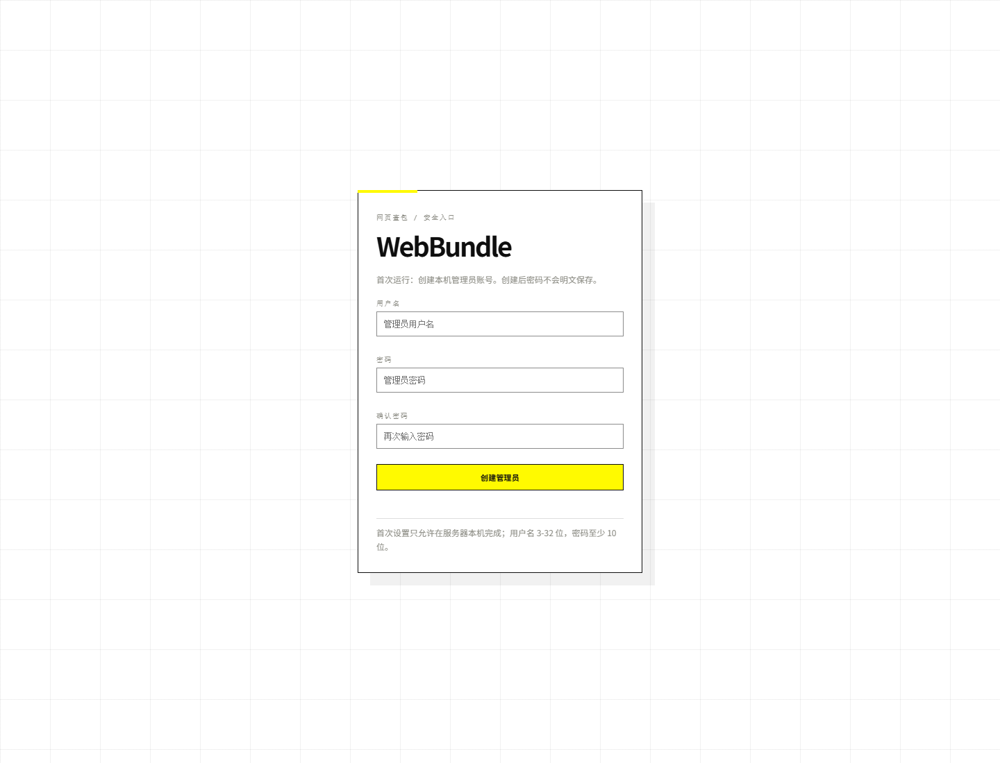
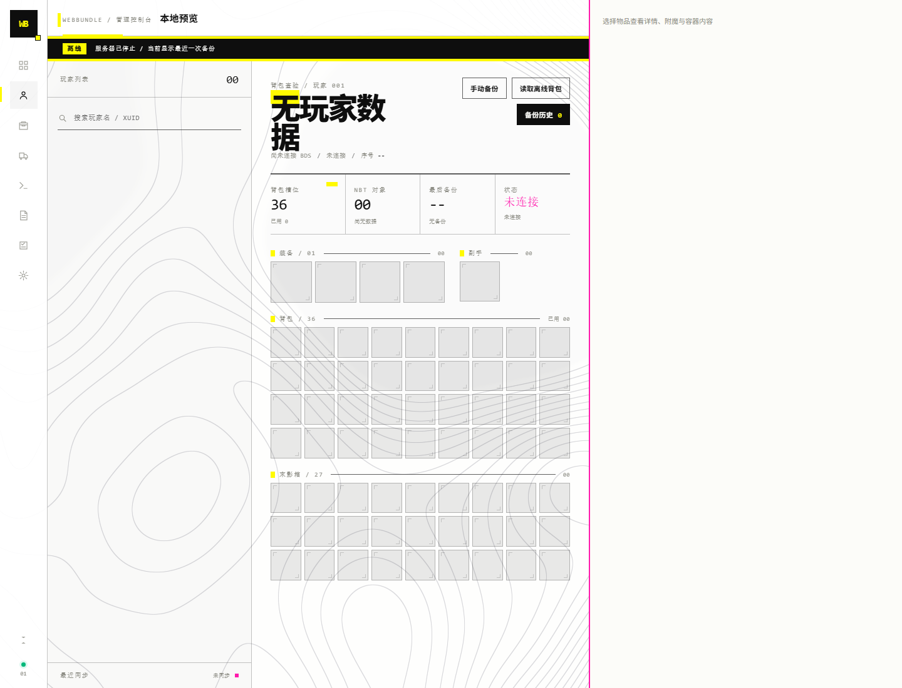

# WebBundle v1.1 实现与运行

> 状态：v1.1 单服实现完成（Cookie 内置页 + 独立网页端 + 最后时刻）
> 设计：[README](README.md) / [00 范围](00-v1范围与运行时探针.md) / [01 架构](01-总体架构与设计决策.md) / [07 单独挂载网页端](07-单独挂载网页端与离线修改.md) / [06 v2](06-v2-外部模式与分布式.md)
> 本文写“代码在哪、怎么跑、验证了什么、v1 边界在哪”。v2 的多服/分布式不是本版本内容。

---

## 1. 代码位置

```
plugins/WebBundle/
├── manifest.json
├── index.js
├── README.md
├── LICENSE
├── src/
│   ├── app.js
│   ├── core.js
│   ├── item.js
│   ├── store.js
│   ├── snapshot.js
│   ├── shadow.js
│   ├── actions.js
│   ├── sha256.js
│   ├── web.js
│   ├── external.js
│   └── modules/
│       ├── host.js
│       ├── command.js
│       └── logistics.js
└── web/
    ├── index.html          v5 单页界面
    ├── app.js              API 接线、任务轮询、附魔/NBT 编辑器
    ├── app.css             白底/等高线主题
    ├── preview.html        视觉稿（演示数据）
    ├── preview.js
    ├── preview.css
    ├── login.html
    ├── setup.html
    └── textures/items/     ZXDash 图标（2487 PNG）

plugins/WebBundle/standalone/
├── server.js
├── package.json
├── config.example.json
├── README.md
└── LICENSE
```

---

## 2. 运行

### 2.1 内置页（形态 A）

1. 放 `plugins/WebBundle`。
2. 启动 BDS。
3. 控制台出现 `[WebBundle] 内置网页监听 127.0.0.1:19380`。
4. 首次令牌打印一次，并写入 `plugins/WebBundle/data/config.json`。
5. 浏览器打开 `http://127.0.0.1:19380`，首次会要求创建本机管理员账号和密码；之后用该账号登录。
   密码在浏览器里用 WebCrypto PBKDF2-SHA256 派生 verifier，服务端只保存 verifier 的 SHA-256，不保存明文密码。

`web/index.html` 也可以直接双击打开：使用相对路径加载 `app.css` / `app.js` / `textures`，显示空状态本地预览，不依赖 BDS。

### 2.2 单独挂载网页端（形态 B）

```bash
node plugins/WebBundle/standalone/server.js
```

首次启动生成 `plugins/WebBundle/standalone/config.json`，**没有默认账号密码，也不打印浏览器凭据**。用本机浏览器打开 `http://127.0.0.1:8080`，`index` 会直接渲染画面；未登录时页内显示登录，首次使用从登录卡片进入 `/setup` 创建管理员。密码只保存 PBKDF2-SHA256 哈希与随机盐。

在 `plugins/WebBundle/data/config.json` 打开：

```json
"external": {
  "enabled": true,
  "url": "http://127.0.0.1:8080",
  "token": "<pushToken>",
  "pollSec": 2
}
```

重启 BDS。停止 BDS 后刷新 `http://127.0.0.1:8080`：应显示最后备份；未启动 `webbundle-web` 时不应有任何网页。

---

## 3. v1 能力清单

| 能力 | 实现 |
|---|---|
| 插件内置网页 | qjs `HttpServer`，静态页 + `/api/v1` |
| 单独挂载网页端 | Node 独立进程 + 独立数据文件 |
| 实时背包 | 进服种子 + `onInventoryChange` 增量 + 2s 轮询 |
| 分钟备份 | 跨分钟在线玩家每分钟一个桶 |
| 进服/退服/手动/还原前备份 | 有 |
| 完整 NBT | 小 NBT 内联，大 NBT `nbtRef` + `/api/v1/nbt/:ref` |
| 修改物品 | 类型/数量/NBT；空槽新建；清空槽位 |
| 修改附魔 | 右侧栏编辑 `ench` / `StoredEnchantments`，写动作 `item.enchants.set` |
| 功能页 | 总览、物品去向、指令、审计、任务、备份、设置（`/api/v1/overview`、`/tasks`） |
| 还原历史背包 | 背包/盔甲/副手 |
| 在线玩家修改 | 容器 API + 动作队列 |
| 离线玩家修改 | `mc.getPlayerNbt` + `mc.setPlayerNbtTags` |
| BDS 关闭时离线修改 | 形态 B 队列 `queued_offline`，开服后执行 |
| 读取离线背包 | `offline.snapshot` 动作，按需生成备份 |
| 网页指令 | 命令模块 + 白名单拒绝 + 任务 |
| 物品去向 | 丢弃/拾取 |
| 模块宿主 | `src/modules/host.js`，内置 `command`/`logistics` |
| 审计 | 单队列 + SHA-256 哈希链 + `/audit/verify` |
| 权限 | 形态 A：`web.role`：`viewer/operator/admin`；形态 B：首次设置管理员账号 |
| 独立网页端登录 | 首次 `/setup` 创建账号；PBKDF2-SHA256 + 盐；HttpOnly 会话 |
| 内置页账号 | 首次运行在网页创建账号密码；浏览器 PBKDF2 派生 verifier，服务端只存 SHA-256 |
| 内置页 Cookie | 登录后换 `wb_web_session` HttpOnly Cookie，刷新不再重复输入 |
| 关服最后时刻 | 独立端显示关服时间、最后玩家、最后备份，可直接进入最后背包 |
| 独立网页入口 | 内置页在独立端在线时显示「独立网页 ↗」跳转 |
| 冷查看 | 仅形态 B；未部署即不可用 |

---

## 4. 接口

### 4.1 网页 API

| 方法 | 路径 | 说明 |
|---|---|---|
| GET | `/api/v1/meta` | 服务器/模式/角色/能力、独立网页端在线状态 |
| GET | `/api/v1/auth/status` | 首次设置状态、当前会话、KDF salt/iterations |
| POST | `/api/v1/auth/setup` | 首次创建管理员（仅本机；收 verifier） |
| POST | `/api/v1/auth/login` | 账号登录（收 verifier）；下发 Cookie |
| POST | `/api/v1/auth/logout` | 清除 Cookie 会话 |
| GET | `/api/v1/last-moment` | 独立端最后时刻（关服前最后备份） |
| GET | `/api/v1/overview` | 总览聚合：玩家、备份、物品去向、审计、热力、系统 |
| GET | `/api/v1/players` | 在线 + 已知离线玩家 |
| GET | `/api/v1/tasks` | 任务列表（可按 `state` 过滤） |
| GET | `/api/v1/players/:xuid/inventory` | 实时/最后备份 |
| GET | `/api/v1/players/:xuid/snapshots` | 备份索引 |
| GET | `/api/v1/snapshots/:id` | 备份详情 |
| GET | `/api/v1/nbt/:ref` | 大 NBT |
| GET | `/api/v1/flow` | 丢弃/拾取 |
| GET | `/api/v1/audit` | 审计记录（admin） |
| GET | `/api/v1/audit/verify` | 哈希链校验（admin） |
| GET | `/api/v1/modules` | 内置模块 |
| GET | `/api/v1/tasks/:id` | 任务状态 |
| GET | `/api/v1/stream?since=` | 内置模式增量 |
| POST | `/api/v1/actions/:id` | 设置/清空/还原/NBT/附魔/备份/离线读取 |
| POST | `/api/v1/commands` | 执行命令（admin） |

### 4.2 插件 → 单独网页端

```
POST /push/v1/register
POST /push/v1/heartbeat
POST /push/v1/snapshot
POST /push/v1/flow
POST /push/v1/audit
GET  /push/v1/actions/pending
POST /push/v1/actions/result
```

单独网页端的网页 API 与 4.1 基本一致，额外支持冷查看；审计记录由插件推送。

---

## 5. 已验证

实际启动 BDS：

- 插件加载成功，日志出现 `内置网页监听 127.0.0.1:19380`。
- 带令牌 `GET /api/v1/meta` 返回 `mode=embedded`、`role=admin`、能力列表。
- 无令牌返回 401；`GET /` 与静态资源返回 200。
- `POST /api/v1/commands` 创建任务，服务器完成世界加载后由 `onTick` 执行，任务变为 `succeeded`。
- `GET /api/v1/audit`、`/audit/verify` 可用；Node 桩测试验证哈希链篡改会变为 `valid=false`。
- `web.role=viewer` 时，写动作返回 403、审计接口返回 403；`admin` 正常。
- `KVDatabase` 在 `plugins/WebBundle/data/db` 创建并打开。

实际启动单独网页端：

- 静态页返回 200。
- `POST /push/v1/snapshot` 写入备份；`GET /players`、`/inventory` 可读。
- `POST /api/v1/actions/inventory.set` 创建 `queued_offline` 任务。
- `GET /push/v1/actions/pending` 返回动作；`POST /push/v1/actions/result` 回写。
- 插件启用 `external` 后注册/心跳，外部 `meta` 显示 `mode=external`、`server.online=true`。
- 通过外部网页提交 `say WebBundleExternal`，插件轮询执行，外部任务变为 `succeeded`。
- 插件推送审计，外部 `/api/v1/audit` 可读、`/audit/verify` 可校验。
- 独立网页端首次启动进入 `/setup`；本机可设置，远程 Host 或带 `X-Forwarded-For` 返回 403；设置后 `/api/v1/meta` 无会话 401，登录 Cookie 后可读。

Node 桩测试：

- 物品序列化、完整 NBT；
- 离线 NBT 写入 `setPlayerNbtTags`；
- 在线 `inventory.set`；
- 命令模块拒绝列表；
- 审计哈希链。

---

## 6. v1 边界

v1 是**单服完整实现**，不是 v2 分布式：

- 没有多服聚合、Redis/Mongo/Cassandra/Spanner/Kafka/Parquet/Iceberg；
- 没有 WebSocket/SSE，页面轮询；
- 第三方模块不加载，只加载内置模块；
- 不直接编辑世界存档；BDS 关闭时只排队；
- 本地持久化用 LSE `KVDatabase`，RocksDB 侧车是可选增强，未内置；
- 形态 B 的数据文件是 JSON，适合单机/小规模，不适合高并发多服；
- 副手只能修改已有副手物品；LSE 没有 `setOffHand`，凭空创建副手不可靠；
- 形态 A 的 Web 令牌以明文存本地配置；生产必须限制文件权限并放在 TLS 反向代理后；
- 形态 B 使用浏览器账号密码（PBKDF2-SHA256 + 盐），不是默认令牌；`pushToken` 是插件机器令牌，必须单独保管；
- 形态 B 当前只有一个管理员账号，没有多用户/角色分级；

**离线查看边界不变：** 形态 A 在 BDS 停止后不可用；只有启动 `webbundle-web` 才有冷查看。未部署它就没有任何网页。

---

## 7. v2 入口

多服/分布式/WS/多租户见 [06](06-v2-外部模式与分布式.md)。  
v2 不是“再加一个配置项”：需要中心 `webbundle-web`、Redis/Mongo/Kafka 适配器、跨服身份与权限、审计归档。v1 不在代码里塞空壳。

---

## 8. 技术栈选择

当前独立网页端是 **Node.js 24 + 零第三方依赖**，原因只是它已在服务器上、便于快速把账号/页面/推送链路跑通。**它不是最优解。**

| 方案 | 优点 | 问题 |
|---|---|---|
| Node.js（当前） | 开发快、与前端同语言、零 npm 依赖也能跑 | 需要 Node 运行时；常驻内存偏高；单线程事件循环；发布包要带 runtime |
| **Rust + axum（推荐）** | 单静态二进制、无运行时、内存可控、并发与类型安全；适合常驻服务 | 开发慢，需要编译；Windows 服务打包要额外处理 |
| Go + net/http | 单二进制、标准库足够、部署最简单 | 本机未安装 Go；生态/模板不如 Rust 贴合现有设计 |
| C# / ASP.NET | Windows 服务体验好、认证库成熟 | 需要 .NET 运行时；跨平台部署更重 |
| Python / FastAPI | 写得快 | 运行时/依赖/并发模型不适合长期常驻的独立层 |

结论：**如果目标是生产部署，Rust/axum 比 Node 更合适。** 本机 Rust 1.96 + axum 0.7 的离线依赖已做过最小编译验证；真正迁移需要把 `server.js` 的 HTTP 路由、JSON 存储、PBKDF2 认证、推送/动作队列重写成 Rust，属于独立改造，不是改个配置。

---

## 9. 当前界面

以下截图由当前前端资源直接渲染，数据为空或处于首次设置状态。

**内置页首次运行：创建管理员账号**



**index.html 直接打开**



## 10. 下一步（v2 或实机加固）

1. 用真实客户端跑探针 B/E/F：`onInventoryChange` 语义、完整 NBT 往返、离线 NBT 标签格式；按实机结果修 `item.js`。
2. 本地 RocksDB 侧车：可独立进程实现，插件通过 HTTP 访问；v1 不默认依赖。
3. 形态 B 多用户/角色分级与密码修改页面。
4. NBT 编辑器语法高亮/diff/确认词。
5. v2 分布式适配器与中心网页。
