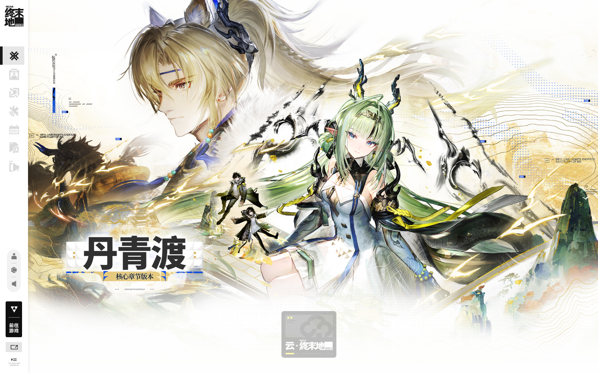

# WebBundle 视觉设计方案 v5

> 状态：v5 已落地到内置页和独立网页端
> v5 修订：补齐总览、物品去向、指令、操作历史、任务、备份、设置页面；附魔编辑在右侧栏；等高线随机生成；界面以中文为主
> 参考：[终末地官网](https://endfield.hypergryph.com/)（仅参考视觉语言，不复制其美术资源）
> 物品渲染：直接复用 ZXDash 的物品图标与槽位逻辑
> 当前实现：[08-实现与运行](08-实现与运行.md) / 视觉稿：[v5-overview.png](preview/v5-overview.png)

---

## 1. 目标

把现在的“深色管理面板”改成 **终末地式的工业档案终端**：

- 纸白、墨黑、信号黄，少量洋红/薄荷绿；
- 大量留白、细线、微缩英文标签、编号、网格；
- 物品用 ZXDash 的像素图标和槽位结构，不再用纯文字格子；
- 数据密度不降：管理员要一眼看到玩家、槽位、NBT、备份历史、状态；
- 不是把官网首页搬进来，而是提取它的**排版、线条、节奏、色彩**。

一句话：**Endfield 的纸面工业感 + Minecraft 的像素物品 + 管理后台的信息密度。**

---

## 2. 参考分析



从参考站提取的不是角色图，而是这些规则：

| 观察 | 转译到 WebBundle |
|---|---|
| 近白纸底、黑色文字 | 主背景 `#F3F0E7`，正文 `#191919` |
| 高饱和信号黄 | 主操作、选中、关键数字用 `#FFFA00`，黑字压在上面 |
| 极细的分隔线、坐标线、点阵 | 1px 墨线、四角刻度；背景不铺网格 |
| 左侧窄竖向图标栏 | 72px 固定 rail，线性图标 + 底部连接状态 |
| 超大中文标题 + 极小英文/编号 | 页面标题 32–44px，辅助标签 10–11px 大写字母间距 |
| 不对称、大留白 | 左侧玩家 manifest 320px，右侧背包区留白，详情抽屉从右滑出 |
| 工业/档案/扫描感 | 槽位角标、条形码、`FIELD ARCHIVE` 微标签、轻微扫描线 |
| 黑色只在局部重压 | NBT 编辑器/终端面板用黑底黄字，其他区域保持纸白 |

当前截图是深色、圆角、块状卡片；新方案会明显更轻、更硬、更“档案”。

---

## 3. 设计原则

1. **大面积纯白**：主背景 `#FCFCF9`，不用米色/深色底；白色区域只承载等高线，不铺栅格。
2. **黄色只做拼接**：主按钮、标题后的色块、section 标记、状态强调；黄色是“拼贴块”，不是整页主题色。
3. **物品是主角**：图标优先于文字；文字只做计数、附魔、耐久、NBT 标记。
4. **黑色是终端**：NBT 编辑、命令输出、冷查看警告用黑底，与白纸形成对比。
5. **微标签是节奏**：`PLAYER / INVENTORY / NBT / AS OF` 这类 10px 大写标签。
6. **不做圆角卡片堆叠**：用 1px 边框、直角、分区线；圆角最多 2–4px。
7. **等高线**：背景使用 WebGL Simplex 噪声生成流动等高线，取局部尺度 1.0，密度 32；高度起伏放大 1.65 倍，上限 0.84 后形成无等高线的平顶区域；线宽按屏幕空间约 1px，不铺栅格。
8. **图标选择态**：rail 未选中为灰色线性图标；选中为黑色实心/黑色描边，左侧亮黄短条。切换栏目时，亮黄指示条纵向滑动 200ms，内容区按切换方向滑入 220ms；减少动态效果模式关闭动画。
9. **附魔单独编辑**：物品抽屉只展示摘要；点“编辑附魔”进入两栏编辑器，当前列表 + 添加区，交互对齐 Web-InvInspector。

---

## 4. 设计 Token

```css
:root {
  --paper: #FCFCF9;
  --paper-2: #F3F3EE;
  --paper-3: #E8E8E1;
  --ink: #0E0E0E;
  --ink-2: #2E2E2B;
  --muted: #8C8C84;
  --line: rgba(14, 14, 14, 0.14);
  --line-strong: rgba(14, 14, 14, 0.48);
  --signal: #FFFA00;
  --signal-ink: #0E0E0E;
  --alert: #FF1AAC;
  --ok: #00B87A;
  --info: #2B4BFF;
  --terminal: #0E100E;
  --terminal-ink: #F2F2EC;
  --terminal-signal: #FFFA00;
}
```

字体：

- 中文标题：`HarmonyOS Sans SC Black / Noto Sans SC 900 / 思源黑体 Heavy`，系统回退。
- 正文：`Noto Sans SC / 微软雅黑`。
- 数字/ID/时间：`Space Grotesk / IBM Plex Mono / Consolas`，等宽优先。
- 不引入外部字体 CDN；离线部署用本地字体或系统字体。

尺寸：

- rail：72px（移动 56px）
- 顶栏：48px
- 玩家 manifest：320px
- 物品槽：桌面 62×62，间距 4px；9 列主背包
- 详情抽屉：420px
- 圆角：0–4px
- 动效：120–180ms，`prefers-reduced-motion` 关闭

---

## 5. 页面骨架

```text
┌──────┬──────────────────────────────────────────────────────────┐
│ LOGO │  WEB BUNDLE / FIELD ARCHIVE      SERVER 01   ● ONLINE   │ 48
│      ├──────────────────────────────────────────────────────────┤
│  ▣   │  PLAYER MANIFEST        │  INVENTORY / EQUIPMENT         │
│  ◈   │  001  Steve       ONLINE│  ┌──┬──┬──┬──┬──┬──┬──┬──┬──┐  │
│  ▤   │  002  Alex        ONLINE│  │  │  │  │  │  │  │  │  │  │  │
│  ⌁   │  003  Notch       OFFLINE│ └──┴──┴──┴──┴──┴──┴──┴──┴──┘  │
│  ▦   │                         │  ARMOR / OFFHAND / ENDER       │
│      │  搜索 / 过滤             │                                │
│      │                         │  [ 物品详情抽屉 420px → ]       │
│  ◉   │                         │                                │
└──────┴─────────────────────────┴────────────────────────────────┘
```

- 左侧 rail：总览、玩家、背包、物品去向、指令、操作历史、任务、设置；底部连接状态。
- 顶栏：服务名、服务器 ID、数据时间、在线/冷查看状态。
- 玩家列：编号 + 名字 + xuid 微标签 + 方形在线点；选中行左侧 3px 黄色竖条。
- 背包区：分区标签 `EQUIPMENT 01`、`INVENTORY 36`、`ENDER 27`；每区一条细线。
- 详情抽屉：点击物品后从右覆盖，纸白底、黑色 1px 边框；NBT 区黑底。
- 冷查看：顶部黄色/黑斜纹警示条，`OFFLINE / DATA AS OF`，不用红色大横幅。

---

## 6. 物品渲染：直接复用 ZXDash

### 6.1 复用清单

| ZXDash 位置 | 内容 | 处理 |
|---|---|---|
| `plugins/ZXPanel/web/src/js/domains/core.js:164` | `getItemIconUrl(type)` → `/textures/items/<type>.png` | 原样使用 |
| `core.js:169` | `getItemIconHtml`，`image-rendering: pixelated` | 原样使用 |
| `core.js:177` / `194` | 附魔/lore/耐久/容器内容摘要 | 复用结构，换配色 |
| `inventory.js:649` | `renderSlot`：图标 60% 居中、数量、附魔、耐久条、容器角标 | 复用结构 |
| `inventory.js:210` | `renderInventoryUI` 分区布局 | 复用分区，不搬内联样式 |
| `inventory.js:700` | `showRoItemDetail` 只读详情 | 复用信息层级 |
| `css/components.css:146` | `.mc-slot` 尺寸、hover、数量、耐久条 | 复用尺寸逻辑，重写颜色 |
| `web/textures/items` | 4118 个物品 PNG | 复制到 WebBundle |

### 6.2 纹理接入

- 复制 `plugins/ZXPanel/web/textures/items/*.png` 到 `plugins/WebBundle/web/textures/items/`。
- 路径规则完全沿用：`/textures/items/<type 去掉 minecraft:>.png`。
- **纹理修正**：ZXDash 目录里有 1592 个 `.png` 实际是 WebP，已统一转成真正的 PNG；通用 `shulker_box.png` 源文件本身是彩色竖条坏图，已用 `undyed_shulker_box.png` 替换。
- 插件内置网页新增二进制静态路由：
  - `GET /textures/items/*.png` → `File.readFrom(path, true)` → `res.write(ByteBuffer)`；
  - `Cache-Control: public, max-age=86400`；
  - 路径禁止 `..`，找不到返回 404，不回落 index。
- 独立网页端已有静态文件服务，补 MIME `image/png` 即可。
- 槽位只加载可视区域：`loading="lazy"` + 固定宽高，避免 36/27 个图标造成布局抖动。
- 图标 URL 带版本参数 `?v=4`，避免浏览器继续用旧坏图缓存。

### 6.3 数据适配

WebBundle 当前物品字段是 `{t,c,n,l,nbt,nbtRef}`；ZXDash 槽位需要 `type/count/name/lore/enchants/durCur/durMax/containerItems/potionType`。

建议在 `item.js` 序列化时补一个 `meta` 对象，只解析一次并按 NBT hash 缓存：

```
item.meta = {
  displayName, enchants:[{id,name,level}], lore,
  durCur, durMax, potionType, containerItems:[{type,count}]
}
```

前端适配器：

```js
function zxItem(item) {
  return {
    type: item.t,
    count: item.c,
    name: item.n || item.t,
    lore: item.l?.join("\n") || "",
    enchants: item.meta?.enchants || [],
    durCur: item.meta?.durCur || 0,
    durMax: item.meta?.durMax || 0,
    containerItems: item.meta?.containerItems || [],
    potionType: item.meta?.potionType || "",
    nbtRef: item.nbtRef || null
  };
}
```

没有 `meta` 时只显示图标 + 数量 + NBT 点，不阻塞。

### 6.4 槽位外观

```text
┌────────────┐  62×62
│ ╲        ╱ │  1px 墨线；四角 4px 刻度
│   [ICON]   │  图标 60%，pixelated
│            │
│ ●      16  │  NBT 点（洋红）/ 数量（等宽）
└────────────┘  底部耐久 2px 条
```

- 空槽：纸白底 + 极淡点阵，不画文字，只保留角标。
- 有物品：图标居中；物品名不塞进格子（空间不够，像素图标优先）。
- 数量 >1：右下角等宽数字，黑底黄字小标签。
- NBT：左下角 5px 洋红方块；hover 显示 `NBT` 微标签。
- 附魔：槽位底部 9px 薄荷绿/紫色短线，或只在 hover 卡显示；不要挤占图标。
- 耐久：底部 2px，>50% 薄荷绿，20–50% 黄，<20% 洋红。
- 选中：外框 2px 信号黄 + 左上角黑色 `SELECTED` 微标签。
- hover：黄框 + 右上角物品类型短 ID；不使用放大动画。

---

## 7. 组件设计

### 7.1 玩家 manifest

- 行高 52px；左侧 24px 编号（等宽、浅灰）。
- 名字 15px 黑体；xuid 10px 等宽灰。
- 右侧方形状态：在线黄绿、离线空心墨线。
- 选中：左侧 3px 黄条、背景 `--paper-2`、名字变黑加粗。
- 搜索框：无圆角、1px 底线，聚焦变 2px 黄线。

### 7.2 物品详情抽屉

- 420px；纸白；左侧 1px 墨线；顶部大号物品图标 96px。
- 标题 24px 黑体；类型 ID 10px 等宽；数量、附魔、耐久用标签行。
- NBT 区域：黑底 `--terminal`，黄/白等宽文本，行号可选；高度 40vh。
- 操作：黄底黑字“保存物品”，黑底黄字“仅保存 NBT”，描边“刷新/清空”。
- 危险操作：洋红 1px 边框 + 二次确认，不使用红色大面积。

### 7.3 备份历史

- 左侧一条 1px 墨线，节点用 6px 方块。
- 每行：`14:32` 等宽 + reason 大写 + 件数 + hash 前 8 位。
- 还原按钮：黄底黑字小按钮；hover 黑底黄字。

### 7.4 物品去向 / 操作历史

- 表格无斑马纹，只有 1px 横线。
- 列标题 10px 大写字母间距。
- 数量用等宽；方向用 `IN / OUT` 微标签。
- 操作记录链状态：`CHAIN OK` 黄底黑字；断链洋红。

### 7.5 冷查看

- 顶部 36px 黄黑斜纹条：`OFFLINE / DATA AS OF 2026-10-21 12:59`。
- 页面其余部分保持纸白，数据区加 1px 墨线边框。
- 写操作可点，但按钮文案改为 `QUEUE FOR NEXT START`；提交后任务标记 `QUEUED`。

### 7.6 登录 / 首次设置

- 纸白卡片，黑色 1px 边框，左上角 `WEB BUNDLE / SECURE ENTRY`。
- 输入框只有底线，聚焦黄线；按钮黄底黑字。
- 不显示任何默认账号/密码；密码框不提供“显示密码”。
- 首次设置页加一行小字：`LOCAL ONLY / ONE-TIME SETUP`。

### 7.7 附魔编辑（右侧栏内）

v4 不再做弹窗。附魔编辑直接在物品右侧栏里，用两个 tab 切换：

- tab：`详情` / `附魔 02`；物品图标、名字、类型始终在顶部。
- `详情`：数量、耐久、NBT、SNBT 终端。
- `附魔`：当前附魔列表 + 添加区 + 保存。
- 当前行：`附魔名 + ID + 罗马数字等级 + −/+ + 移除`；等级直接点按，不再弹输入框。
- 添加区：附魔下拉（名称 + 最高等级）、等级 stepper、黄色“添加”。
- 同类附魔再次添加会覆盖等级；等级由服务端按附魔 ID 上限校验，前端只做钳位。
- 底部 `返回详情 / 保存附魔`；保存后回写物品 NBT 的 `ench`/`StoredEnchantments`，并刷新槽位附魔线。
- 附魔书写 `StoredEnchantments`；普通物品写 `ench`；两者不能混。
- 后续接真实 API 时，附魔 ID 名称表由服务端提供，前端不硬编码完整表。

---

## 8. 动效

- 页面进入：内容 8px 上移 + 透明度 0→1，160ms。
- 抽屉：右侧 16px 滑入，180ms。
- 槽位 hover：边框颜色 120ms；不做缩放。
- 冷查看：顶部条轻微扫描线（4s 循环，低对比）。
- 全部受 `prefers-reduced-motion` 控制。
- 不使用大面积渐变、玻璃拟态、发光。

---

## 9. 响应式

- ≥1280：rail 72 + manifest 320 + 9 列槽位 + 抽屉 420。
- 1024–1279：manifest 280 + 9 列缩小；抽屉覆盖。
- 768–1023：rail 56 + manifest 240；主背包 6 列。
- <768：rail 底部横向；玩家列表变顶部横向滚动；背包 5 列；抽屉全屏。
- 保留键盘 Tab 顺序与 focus 黄框。

---

## 10. 实施顺序

### 阶段 0：确认方案

- 确认浅色纸面为主、黄色为动作色；
- 确认物品格只放图标 + 数量 + NBT 点，不放长名字；
- 确认 NBT 抽屉黑底。

### 阶段 1：纹理与槽位

1. 复制 `textures/items/*.png` 到 `plugins/WebBundle/web/textures/items/`。
2. qjs `web.js` 增加 `/textures/items/` 二进制路由；Node 静态服务补 MIME。
3. 前端引入 `getItemIconUrl` / `zxItem` / `renderSlot`，替换当前文字格。
4. 先不动整体布局，验证图标、数量、NBT 点、hover。

### 阶段 2：数据补充

1. `item.js` 从 NBT 提取 `enchants/dur/potion/containerItems`，按 `h` 缓存。
2. API 返回 `meta`；旧数据无 `meta` 时降级。
3. 验证 4118 个图标中常用物品命中率。

### 阶段 3：版式与主题

1. 新 HTML 骨架：rail + topbar + manifest + inventory。
2. 设计 token 替换现有深色 CSS；保留功能类名减少 JS 改动。
3. 重做登录/首次设置页。
4. 冷查看黄黑条。

### 阶段 4：验收

- 1440×1000、1280×800、390×844 三档截图；
- 36 格 + 27 格图标无布局抖动；
- hover/选中/抽屉/NBT 编辑/冷查看；
- 1000 行列表和 60fps 门槛不退化；
- 无外部字体/CDN，离线可用。

---

## 11. 风险

| 风险 | 处理 |
|---|---|
| 4118 个图标体积/请求多 | 仅 `.png`；lazy；长缓存；固定尺寸；后续可做 sprite |
| qjs 二进制静态响应 | 按需 `File.readFrom(path,true)`，不预载全部；路径校验 |
| ZXDash 代码含全局函数/内联事件 | 只复用渲染逻辑与 CSS 结构，改成模块函数；不搬整页 |
| NBT 解析成本 | 按 NBT hash 缓存；列表只返回 meta，大 NBT 仍走 ref |
| 浅色长时间阅读 | 正文墨黑、对比足够；NBT/命令区黑底；提供后续暗色主题开关 |
| 字体不可用 | 系统字体回退；不依赖 CDN |
| 版权 | 只复用 ZXDash 仓库内已有物品图标与渲染逻辑，不复制官网角色图/CSS |

---

## 12. 功能页面

v5 除玩家背包外，补齐以下页面，全部在同一个左侧 rail 内切换：

| 页面 | 入口 | 内容 |
| --- | --- | --- |
| 总览 | 九宫格图标 | 在线玩家、今日备份、物品去向事件、操作记录链、备份热力、系统状态、最近物品去向/操作历史 |
| 玩家背包 | 人形图标 | 当前已有的玩家、装备、背包、副手、末影箱、物品详情/附魔 |
| 物品去向 | 卡车图标 | 全部/丢弃/拾取筛选、玩家/物品搜索、方向、物品图标、数量、来源、置信度 |
| 指令 | 终端图标 | 指令输入、黑色输出终端、快捷指令、最近执行、危险指令/操作历史/离线队列 |
| 操作历史 | 文件图标 | SHA-256 链状态、动作筛选、操作者/目标/结果/hash、验证按钮 |
| 任务 | 勾选图标 | 排队/执行中/成功/失败筛选、任务 ID、目标、状态、时间、结果 |
| 备份 | 箱子图标 | 分钟/手动/加入/还原前备份历史、物品数、备份 ID、还原按钮、保留策略 |
| 设置 | 滑块图标 | 账号/角色/会话、模块状态、存储驱动、NBT 限制、保留周期 |
| 最后时刻 | 冷查看顶部按钮 | 关服时间、最后玩家、物品数、最后备份、进入最后背包 |

页面已接 `/api/v1`：总览聚合、任务列表、操作历史校验、指令、备份还原和附魔写入均走服务端；独立网页端的动作进入离线队列，开服后由插件执行。

### 12.1 界面截图

- index.html 直接打开：[prod-index-file.png](preview/prod-index-file.png)
- 内置页首次设置：[prod-embedded-setup.png](preview/prod-embedded-setup.png)

生产入口：

```text
http://127.0.0.1:19380       # 内置页，账号登录后使用 HttpOnly Cookie
http://127.0.0.1:8080        # 独立网页端，首次 /setup，之后 /login
```

独立端在线时，内置页显示「独立网页 ↗」；BDS 停止后独立端进入冷查看，顶部「最后时刻 →」可用。

视觉稿仍保留：`node tools/frontend-preview.js` → `http://127.0.0.1:19090/preview.html`。

---

## 13. 静态视觉稿

静态稿用于布局确认，不接后端：

- 入口：`node tools/frontend-preview.js` → `http://127.0.0.1:19090/preview.html`
- 主界面：[preview/v4-main.png](preview/v4-main.png)
- 物品抽屉：[preview/v4-drawer.png](preview/v4-drawer.png)
- 附魔侧栏：[preview/v4-enchants.png](preview/v4-enchants.png)
- 冷查看：[preview/v4-cold.png](preview/v4-cold.png)
- 源文件：`plugins/WebBundle/web/preview.html` / `preview.css` / `preview.js`

当前物品图标来自 `plugins/ZXPanel/web/textures/items`，已复制到 `plugins/WebBundle/web/textures/items`；槽位结构按 ZXDash `renderSlot` 实现。

---

## 14. 需要确认

1. **主色**：大面积纯白 + 等高线 + 墨黑 + 黄色拼接，是否接受？
2. **图标选择**：rail 未选中灰色、选中黑色 + 黄色短条，是否按这个方向？
3. **物品格**：只显示图标 + 数量 + NBT 点，名字放 hover/详情，是否接受？
4. **附魔编辑**：两栏“当前附魔 + 添加附魔”独立层，是否按 Web-InvInspector 的交互？
5. **NBT 抽屉**：黑底终端风格，是否继续？
6. **字体**：系统字体（Noto/微软雅黑 + Consolas）是否够，还是要打包开源字体？

确认后我按“阶段 1 → 阶段 2 → 阶段 3”改代码，先出一版新的插件页和独立页截图，再继续补数据。
